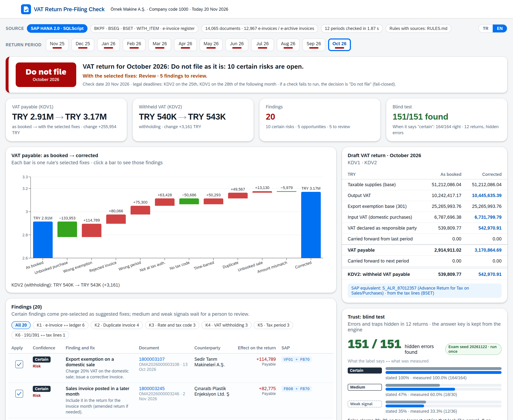
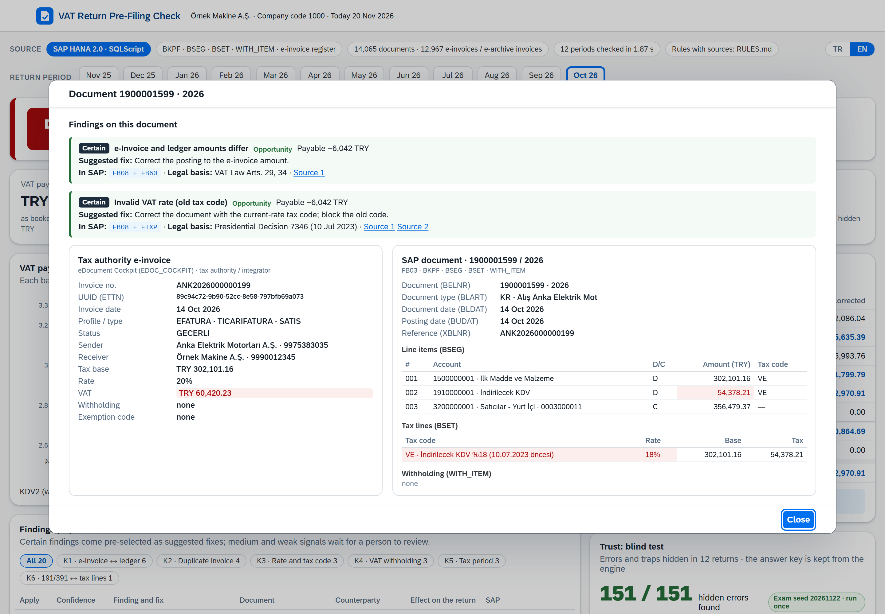
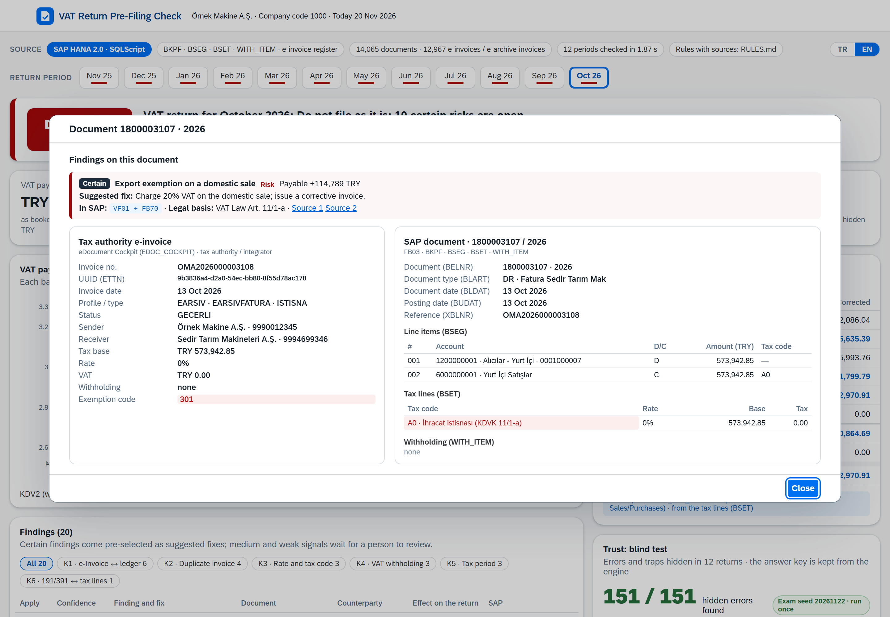
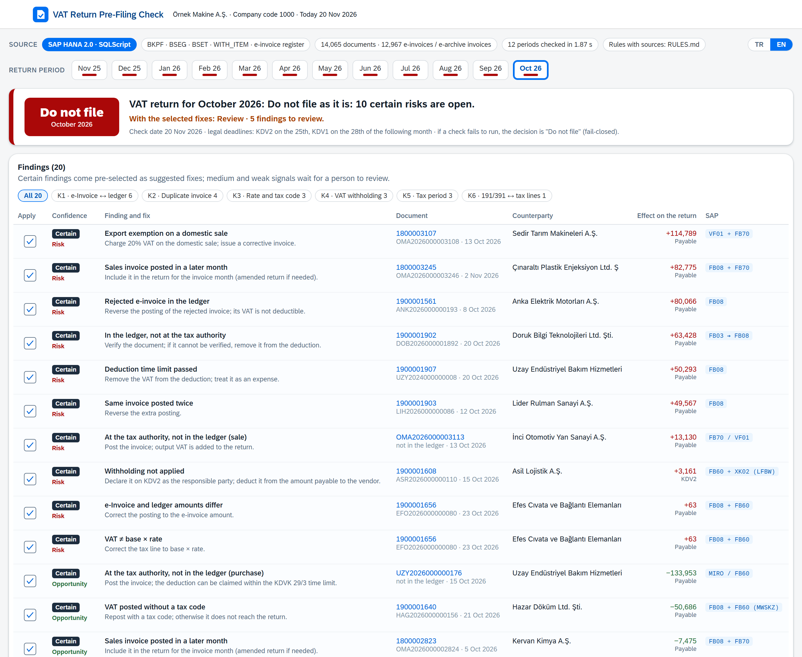
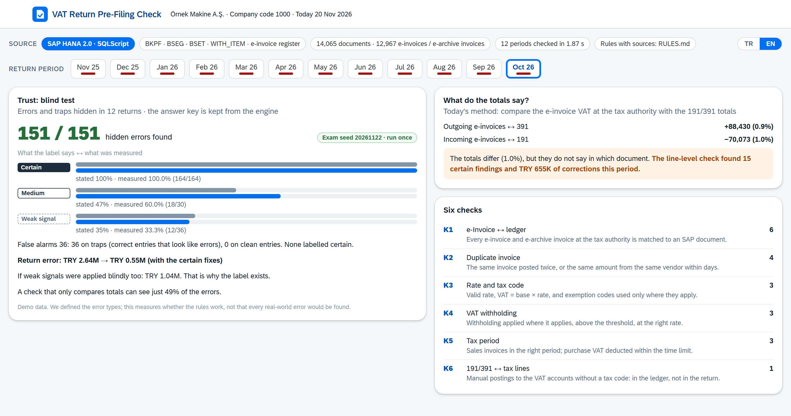
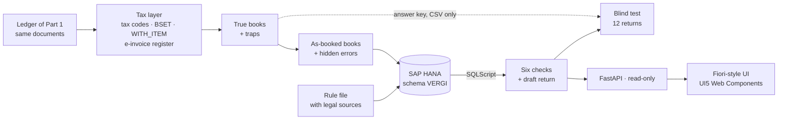

# VAT Return Pre-Filing Check · on SAP HANA, tested blind

> Before the monthly VAT return goes out, a tax manager usually compares two totals: the VAT accounts
> in the ledger against the e-invoice list. When errors cancel each other out, or when the e-invoice
> itself is wrong, the totals agree and the return goes out wrong.
> This app checks **every line**, explains each finding with its document and legal basis, and was
> **tested blind**: 151 errors hidden in 12 monthly returns, with an answer key the engine never saw.

**Second project of my SAP HANA Finance Series.** Part 1: [13-week cash forecast](https://github.com/mmehmetisik/sap-hana-cash-forecast).
Same fictitious company, SAP table structure, Turkish chart of accounts and Turkish VAT rules.

---

## The problem

Turkish companies file a VAT return (KDV1) every month, plus a second return (KDV2) for VAT they
withhold from vendors. The usual check before filing: does the 391 (output VAT) total match outgoing
e-invoices, and does 191 (input VAT) match incoming ones? It cannot see an error that is wrong on
both sides, it cannot see two errors that cancel out, and it never says which document is wrong.
Mistakes surface in a tax audit, years later, as an amended return and a penalty.

## In 60 seconds

1. **A decision before filing.** *"October 2026: do not file as it is — 10 certain risks are open."*
   If a check fails to run, the answer is also "do not file" (fail-closed).
2. **As booked → corrected.** The VAT payable moves from TRY 2.91M to TRY 3.17M once the certain fixes
   are applied. A waterfall shows which rule moves it and by how much.
3. **Every finding drills down.** The tax authority's e-invoice and the SAP document side by side,
   with the fields that disagree in red. Each finding carries a suggested fix, the SAP transaction
   that does it (FB08, FB60, FTXP …) and its legal basis with sources.
4. **People decide.** Certain findings come pre-selected; medium and weak signals wait for a person.
   Each tick recalculates the return in milliseconds.
5. **The trust card.** How often each confidence label was right in the blind test.

| An old 18% tax code still in use | A domestic sale booked as an export | All findings | Blind test |
|---|---|---|---|
|  |  |  |  |

The interface is bilingual (Turkish / English).

## The numbers

All measured on the exam seed, run once. Commands and outputs: [EVIDENCE.md](EVIDENCE.md).

| Measurement | Result |
|---|---|
| Blind test | 12 monthly returns (Nov 2025 – Oct 2026) · **151 hidden errors** of 16 types · **889 traps** (correct entries that look like errors) |
| Errors found | **151 / 151** — every type, in full |
| When it says "certain" | **164 / 164 right.** No certain alarm on any trap or clean entry. |
| What each label says vs. what was measured | Certain 100% → **100%** · Medium 47% → **60%** (18/30) · Weak signal 35% → **33%** (12/36) |
| False alarms | 36, all medium or weak, all on traps · **0 on clean entries** |
| Error in the return | **TRY 2.64M → TRY 0.55M** with the certain fixes (−79%). Applying weak signals blindly too: TRY 1.04M. |
| A check on totals only | sees **49%** of the error volume. In March 2026 the totals differed by just 0.45% and 0.44% — they look reconciled — while TRY 334K of errors sat inside. |
| Speed | All six checks for one period: **0.085 s** (median, SQLScript in HANA) · a tick recalculates the return in ~15 ms |
| Data | 14,065 SAP documents · 39,978 journal lines · 12,967 e-invoices and e-archive invoices · 28 months |
| Tests | 41. Reverting each of three critical fixes turned its test red. |

> **Note:** All data is **demo data** (sample company: Örnek Makine A.Ş.); tax numbers are fictitious.
> We wrote both the error types and the rules, so this measures whether the rules work as specified,
> not that every real-world error would be found. Recall and label accuracy must be re-measured on real data.
> **This is not tax advice.** The rules and their sources are listed in [RULES.md](RULES.md) for review by a Turkish tax advisor.

## How the blind test works

- **Two sets of books.** The *true* books are the clean ledger plus traps. The *as booked* books are the
  true books plus hidden errors. Only the as-booked books are loaded into HANA. The answer key lives in a
  CSV file and never reaches the database; the engine only reads HANA.
- **The key is checked against itself.** For every period and every return line, the effects listed in
  the key add up exactly to the difference between the two sets of books, to the kuruş.
- **Hidden errors (16 types):** an outgoing e-invoice never booked · an incoming one never booked ·
  a purchase invoice the tax authority has never seen · a VAT amount typed wrong · a rejected e-invoice
  still booked · the same invoice twice · a duplicate with its number retyped · an old 18% tax code ·
  a domestic sale booked with the export exemption · withholding missing · withholding at the wrong rate ·
  a sale posted in the next month · VAT deducted after the time limit · VAT posted without a tax code ·
  a vendor billing one delivery twice · an invoice split to stay under the withholding threshold.
- **Traps (889):** purchase invoices booked a month late (legal) · two real orders of the same amount ·
  small freight invoices under the threshold · rejected and cancelled invoices left unbooked · 274
  machinery-repair invoices with no withholding (correct: the company is not a designated buyer) · 457
  import invoices that never appear in the e-invoice system · month-end VAT offset entries without a tax code.
- **No look-ahead.** Each period is checked only with what was posted by the 25th of the following month,
  the KDV2 deadline. The engine never sees later postings.
- **Exam discipline.** The rules were written on development seeds 101–103. The accuracy each label states
  was fixed from those seeds before the exam. Seed 20261122 then ran once, and the SHA-256 of every engine
  file at that moment is recorded in [EVIDENCE.md](EVIDENCE.md).

## Turkish VAT rules it encodes

One rule file feeds the engine, the API, the interface and [RULES.md](RULES.md). Each row has its legal basis,
sources and a status: ✅ verified, 🟡 secondary source, 🔵 assumption.

- VAT rates of 1%, 10% and 20% since 10 July 2023 (before: 1%, 8%, 18%). An old 18% code is a certain error.
- Partial withholding applies above the invoice threshold, VAT included: TRY 9,900 in 2025, TRY 12,000 in 2026.
- Freight transport: 2/10 for any VAT-registered buyer. Iron and steel products: 5/10.
  Machinery repair: 7/10, **but only for designated buyers** — the demo company is not one, so a naive rule
  would raise 274 false alarms here.
- Input VAT can be deducted until the end of the year after the invoice year (VAT Law Art. 29/3).
- Output VAT belongs to the period of the taxable event (VAT Law Art. 10).
- The Ba-Bs forms were abolished from the September 2024 period on, so there is no check for them.

## Faithful to SAP

- **Tax lines in `BSET`.** SAP's advance VAT return (S_ALR_87012357) reads tax lines, not account balances.
  The draft return here does the same, so a VAT amount posted without a tax code shows up in the ledger
  but not in the return — exactly what check K6 finds.
- **Tax codes:** `T007A` / `T007S` (procedure `TAXTR`) and the rate from the condition record, `A003 → KONP`.
  `KONP.KBETR` holds percentages in per mille: 20% = 200.
- **VAT withholding** as extended withholding tax: `WITH_ITEM` (the base is the VAT amount; `WT_QBSHH` is the
  VAT declared on KDV2) and the vendor master `LFBW`. A missing `LFBW` entry is a typical cause of missing
  withholding; the suggested fix names XK02.
- `MWSKZ` on `BSEG` and `ACDOCA`; `BKPF`, `BSEG`, `ACDOCA`, `KNA1`, `LFA1` with SAP field names.
- **Turkish e-invoices:** 16-character invoice numbers, a UUID per invoice (ETTN), profiles TEMELFATURA,
  TICARIFATURA, IHRACAT and EARSIVFATURA, exemption code 301 for exports, statuses such as a rejected
  commercial invoice. They sit in `GIB_EBELGE`, the tax authority side, which is not an SAP table.
- Document numbers and e-invoice numbers are the same as in Part 1: same company, same ledger, seen through tax.

## What happens in HANA

- **SQLScript table functions** ([`hana/checks.sql`](hana/checks.sql), tables in [`hana/schema.sql`](hana/schema.sql)):
  - `TF_BELGELER(day)`: one row per document as of that day, with its VAT in the ledger, its tax lines and its withholding.
  - `TF_K1_EBELGE` … `TF_K6_KODSUZ`: the six checks; `TF_KONTROLLER` runs them all.
  - `TF_BEYANNAME_AYLIK`, `TF_MUTABAKAT`, `TF_TOPLAM_KONTROLU`: the draft return, the month-end reconciliation, and the totals-only check.
  - The identifiers are Turkish; the glossary is at the top of each SQL file.
- Every finding carries its own correction (`ETKI_*`), computed in SQL. When two rules flag the same document
  and line, the correction counts once.
- **The API connects with a read-only user.** HANA rejects a write attempt with `insufficient privilege`.
- The rule book (`KURAL_*` tables) is generated from one Python file; it is never edited by hand.

## How it works

## Caught along the way

- **A rule that no longer exists.** The first plan had a Ba-Bs check. Those forms were abolished from the
  September 2024 period on, so the check was dropped before it was written.
- **A trap in the law.** The 7/10 withholding on machinery repair applies only to designated buyers. Instead
  of a rule, it became a trap: 274 repair invoices that a naive check would flag.
- **The answer key checked itself.** On seed 103 the key and the two sets of books disagreed in January 2026.
  The cause: a planted split invoice took the document number of a correct invoice in the true books and
  overwrote it. Fixed and locked in by a test (reverting the fix turns it red).
- **A label renamed.** On the development seeds, the middle label was right 47% of the time. Calling it
  "likely" would have been overconfident, so it is "medium".

## Limits

- All data is demo data. Error types and traps are ours; real data will have errors we did not think of.
- One company code; one VAT rate per invoice; import VAT paid at customs is not modelled.
- Three withholding types. Which products fall under the iron-and-steel list is set per vendor in the demo;
  in reality it is decided by customs tariff code.
- The e-invoice code numbers (624, 627, 603, 301) come from secondary sources; check them against the current UBL-TR code list.
- No penalty calculation: the app shows the effect on the return, not the penalty.
- Review by a Turkish tax advisor is pending.

## Connecting to a real SAP system

This prototype is not connected to a live SAP system. The checks and the interface stay the same; the data layer changes.

1. **Data:** journal entries and tax items (`BSET` or the corresponding CDS views / OData APIs), withholding
   items, and the e-invoice inbox and outbox from SAP Document and Reporting Compliance or the integrator.
2. **Mapping:** the company's tax codes and withholding codes, its designated-buyer status, and which vendors
   and products fall under each withholding type.
3. **Re-measurement:** run the blind test on the company's own history and let a tax advisor review the rules.

## Tech

SAP HANA Express 2.0 SPS 08 (Docker) · SQLScript · `hdbcli` · Python 3.12 · FastAPI · React 19 ·
UI5 Web Components 2.29 (SAP Fiori Horizon) · Recharts · pytest

## What is in this repository

- This README and the screenshots in [`images/`](images/). A script takes them from the running app; nothing is edited by hand.
- The HANA schema and the six checks in SQLScript: [`hana/schema.sql`](hana/schema.sql), [`hana/checks.sql`](hana/checks.sql).
- The rules with legal sources: [`RULES.md`](RULES.md).
- Small sample data: [`sample-data/`](sample-data/) — the two documents in the screenshots, a withholding invoice,
  an export, their e-invoices, the tax codes and the rule book. Texts are Turkish, as in a Turkish company's SAP
  system: *Hesaplanan KDV* = output VAT, *İndirilecek KDV* = input VAT, *İhracat istisnası* = export exemption,
  *KDV tevkifatı* = VAT withholding.
- The commands and outputs of every measurement: [`EVIDENCE.md`](EVIDENCE.md).
- The engine's source code is not in this repository.

## Data and trademarks

All data is demo data. Örnek Makine A.Ş. and all customer and vendor names are fictitious; tax numbers are
fictitious; any resemblance to real persons or companies is coincidental. This is not tax advice. SAP, SAP HANA,
SAP S/4HANA and SAP Fiori are trademarks of SAP SE. This project is not affiliated with SAP SE.

---

**Author:** Mehmet Işık · [mehmetisik.dev](https://mehmetisik.dev) · [GitHub](https://github.com/mmehmetisik)
